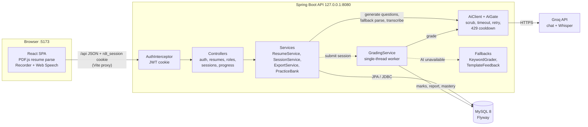

# Abhyas.tech

**Defend your resume.** Abhyas.tech turns your resume into interview questions, grades your answers and keeps asking
the weak ones until you have mastered them.

**Meant for localhost use only.** The backend binds to `127.0.0.1`. Do not expose it to a network without a security review.

## Contents

- [Features](#features)
- [Tech stack](#tech-stack)
- [System architecture](#system-architecture)
- [Project structure](#project-structure)
- [Getting started](#getting-started)
- [Configuration](#configuration)
- [API overview](#api-overview)
- [Data model](#data-model)
- [Tests](#tests)
- [Security and privacy](#security-and-privacy)
- [Docs](#docs)
- [License](#license)

## Features

- **Resume upload.** The PDF is parsed in the browser (OpenResume parser on PDF.js). If that parse is poor, the backend
  tries a fallback (PDFBox plus AI). You review and edit the result before anything is saved.
- **Target role.** Pick one of the starter software development roles or add your own. The app shows which of the
  role's skills your resume covers.
- **Two practice modes.**
  - *Quiz*: 19 questions mixing multiple-correct, fill-in-the-blank, brief written and code answers.
  - *Interview*: 6 spoken questions, each with one AI follow-up. Design questions are graded on five areas.
- **Voice answers.** Recorded in the browser and transcribed by Whisper. You also get words per minute and a count of
  filler words. If transcription is unavailable you can type the answer instead.
- **Grading and feedback.** Each answer is marked against a checklist of key facts, quoting the sentence that earned
  each mark. The report lists marks by part and your weakest resume points.
- **Mastery loop.** A question counts as mastered at full marks (multiple-correct, fill-in-the-blank) or 80% (all other
  types). The next session asks unmastered questions first (lowest score, then oldest). Mastered questions come back
  after a month.
- **Works without AI.** With no Groq key, or while Groq is rate-limited, the app uses a reviewed question bank, a keyword
  grader and template feedback.
- **History and export.** Look over past sessions and export a finished one as JSON (phone and email removed).

## Tech stack

| Layer | Technology |
|---|---|
| Frontend | React 19, React Router, Vite, PDF.js (OpenResume parser), Web Speech API |
| Backend | Spring Boot (Java 21, Maven), Spring MVC, Spring Data JPA, JDBC templates, PDFBox, Nimbus JOSE JWT |
| Database | MySQL 8 with Flyway migrations |
| AI (optional) | Groq: `openai/gpt-oss-120b` for chat and `whisper-large-v3-turbo` for transcription |

## System architecture



### Components

- **Frontend (`frontend/`).** A single-page React app. The browser only talks to Vite on `:5173`, and Vite forwards
  `/api` to Spring Boot, so everything is one origin and the session cookie works without CORS. The resume PDF is
  parsed in the browser, and the browser never calls an AI provider directly.
- **API layer.** `AuthInterceptor` checks the `rdt_session` cookie (HS256 JWT, 8 hours) on every `/api` request except
  signup, login and logout, and puts the user ID on the request. Every query is scoped to that user. `ProblemHandler`
  turns errors into problem-detail JSON with no stack traces.
- **Domain packages (`backend/.../trainer/`).**
  - `auth`: signup, login (5 failures block a login ID for 5 minutes), logout, account read and delete.
  - `resume`: saves reviewed resumes and their points, matches skills as whole words, writes AI project questions,
    and runs the PDFBox fallback parse.
  - `role`: role search over starter roles and your own.
  - `session`: builds sessions from the question pool, records attempts and follow-ups, transcribes audio, grades,
    and builds reports, progress and exports.
  - `ai`: the only code that calls an AI provider.
- **AI gate (`ai/`).** `AiClient` removes emails and phone numbers from prompts (`Scrubber`), asks for JSON only, applies
  a timeout (20 s for chat, 40 s for Whisper), validates the reply and retries once. When a provider sends a rate-limit
  reply, `AiGate` marks it unavailable until its `Retry-After` time (15 minutes if there is none) or until UTC midnight.
  An empty result means "unavailable" and the caller switches to its fallback.
- **Grading worker.** Submitting a session queues it on a single-thread executor, so Groq calls go out one at a time.
  Stage A marks every answer and sets the total. Stage B fills in template feedback where the AI wrote none and writes
  the report. Both stages pick up only the work still open, so a restart carries on where it stopped. The report page
  polls until grading finishes.
- **Database.** MySQL 8 with schema `validate`. Flyway owns all DDL (`backend/src/main/resources/db/migration`), and all
  timestamps are UTC.

### Main flows

1. **Resume:** upload PDF, parse in the browser (or `POST /api/resumes/parse-fallback`), review, then `POST /api/resumes`.
   After the save, one AI call writes about 8 project questions with their own key facts.
2. **Practice:** `POST /api/sessions` picks questions (unmastered first, then new ones, then mastered ones not asked for
   a month). Answers are saved with `PUT /api/sessions/{id}/attempts/{position}`. Voice answers go through
   `.../transcribe` first.
3. **Grade:** `POST /api/sessions/{id}/submit` hands the session to the grading worker. Scores update mastery per user,
   either on the question itself or in `bank_performance` for shared bank questions.
4. **Review:** the report, `GET /api/resumes/{id}/progress`, History and `GET /api/sessions/{id}/export`.

## Project structure

```
.
├── backend/                      Spring Boot API
│   ├── pom.xml
│   └── src/main/
│       ├── java/tech/abhyas/trainer/
│       │   ├── ai/               AiClient, AiGate, Scrubber, Groq transport
│       │   ├── auth/             JWT cookie auth, login throttle, account
│       │   ├── common/           ApiException, ProblemHandler
│       │   ├── resume/           resumes, skill matching, fallback parse, project questions
│       │   ├── role/             role search
│       │   └── session/          sessions, grading, practice bank, export, progress
│       └── resources/
│           ├── application.yml
│           └── db/migration/     Flyway V1..V12
├── frontend/                     React + Vite SPA
│   ├── vite.config.js            /api proxy to 127.0.0.1:8080
│   └── src/
│       ├── *.jsx                 pages: Landing, Login, Upload, Review, Practice, Interview, Report, History, ...
│       ├── api/client.js         fetch wrapper
│       └── lib/                  recorder, speech, rich text, OpenResume parser copy
├── docs/                         architecture, database, flow diagrams and study guide
├── .env.example                  environment variable names
└── LICENSE                       AGPL-3.0
```

## Getting started

### Prerequisites

- Java 21 or newer and Maven
- Node.js 20.19 or newer (Vite 8)
- MySQL 8.0.16 or newer (check with `SELECT VERSION();`)
- Optional: a [Groq](https://console.groq.com) API key

### Setup (Windows)

1. Create the database and user:
   ```sql
   CREATE DATABASE resume_trainer CHARACTER SET utf8mb4 COLLATE utf8mb4_0900_ai_ci;
   CREATE USER 'trainer'@'localhost' IDENTIFIED BY '<password>';
   GRANT ALL PRIVILEGES ON resume_trainer.* TO 'trainer'@'localhost';
   ```
   If the `mysql` command is not on your PATH, use MySQL Shell instead: `\connect root@localhost`, then `\sql`, then
   paste the statements.
2. Set the environment variables (see [Configuration](#configuration)).
3. Backend: `cd backend`, then `mvn spring-boot:run`. Flyway creates the tables and seeds roles, skills and the question
   bank on first start.
4. Frontend: `cd frontend`, `npm install`, `npm run dev`, then open http://localhost:5173.

Sign up on the first screen. Then upload a resume, review it, practice, read the report and export a finished session
from History.

## Configuration

Set these as environment variables, or put them in the gitignored `backend/src/main/resources/application-local.yml`.
Never commit values.

| Variable | Required | Description |
|---|---|---|
| `DB_URL` | yes | JDBC URL. Must contain `serverTimezone=UTC`, e.g. `jdbc:mysql://localhost:3306/resume_trainer?serverTimezone=UTC` |
| `DB_USER` | yes | Database user (default `trainer`) |
| `DB_PASSWORD` | yes | Database password |
| `JWT_SECRET` | yes | At least 32 bytes. The app refuses to start without it |
| `GROQ_API_KEY` | no | Turns on AI questions, grading, follow-ups and voice transcription. Without it the app uses the question bank and keyword grading, and voice answers must be typed |

Other settings (model names, timeouts, upload limits of 1 MB for PDFs and 5 MB for audio) are in
`backend/src/main/resources/application.yml`.

## API overview

All routes are under `/api` and need the session cookie, except signup, login and logout.

| Method | Path | Purpose |
|---|---|---|
| POST | `/auth/signup`, `/auth/login`, `/auth/logout` | Account and session cookie |
| GET / DELETE | `/me` | Current user / delete account and all data |
| GET | `/roles` | Search roles |
| POST / GET | `/resumes` | Save a reviewed resume / list resumes |
| GET / DELETE | `/resumes/{id}` | One resume / delete it |
| GET | `/resumes/{id}/role-skills-check` | Role skills found in the resume |
| POST | `/resumes/parse-fallback` | Server-side PDF parse |
| GET | `/resumes/{id}/progress` | Mastery progress |
| POST / GET | `/sessions` | Start a session / list sessions |
| GET | `/sessions/{id}` | Session state or report |
| PUT | `/sessions/{id}/attempts/{position}` | Save an answer |
| POST / PUT | `/sessions/{id}/attempts/{position}/follow-up` | Get / answer the interview follow-up |
| POST | `/sessions/{id}/attempts/{position}/transcribe` | Transcribe a voice answer |
| POST | `/sessions/{id}/attempts/{position}/regrade` | Grade one answer again |
| POST | `/sessions/{id}/submit`, `/sessions/{id}/abandon` | Finish or drop a session |
| GET | `/sessions/{id}/export` | Export a graded session as JSON |

## Data model

Main tables (see `docs/database.html` for the diagram):

- `app_user`: accounts.
- `role`, `role_alias`, `skill`, `skill_alias`, `role_skill`: the role and skill catalog (starter rows plus user-owned roles).
- `resume`, `resume_point`, `gap_result`: a saved resume, its bullet points and the role skill check.
- `bank_question`: the reviewed practice bank. `format` marks design and code questions, and `track` marks backend or
  frontend questions.
- `question`: questions for one resume (from the bank or written by AI), with key facts, last score and mastery.
- `bank_performance`: per-user score and mastery for bank questions.
- `practice_session` (`mode` is `quiz` or `interview`) and `attempt`: answers, marks, feedback and voice stats.

## Tests

- Frontend: `node --test frontend/src/lib/*.test.js` (Node's built-in test runner, no install needed). The `*` glob
  expands in Git Bash but not in PowerShell.
- Backend: there is no test suite yet.

## Security and privacy

- Localhost only. The server binds to `127.0.0.1`, and the cookie is not `Secure` because there is no HTTPS.
- Passwords are stored as BCrypt hashes. Sessions use an HttpOnly, SameSite=Strict JWT cookie.
- AI keys stay in the backend. Emails and phone numbers are removed before any text goes to an AI provider.
- Uploaded PDFs and audio are held in memory for the request only and never stored.
- Logs hold only IDs and error classes, never request bodies. Error replies never include messages or stack traces.
- Exports remove phone and email. Deleting your account deletes all your data.

## Docs

The `docs/` folder has standalone HTML diagrams; open them in a browser:

- `architecture.html`: components and connections
- `database.html`: the schema
- `dataflow.html`, `sequence.html`, `workflow.html`, `lifecycle.html`: request flows and session lifecycle
- `study-guide.md` / `study-guide.html`: the whole stack explained from the basics up

## License

AGPL-3.0, see `LICENSE`. Copyright (C) 2026 Nilanchal Jena. The resume parser in `frontend/src/lib/openresume/` is copied from
[OpenResume](https://github.com/xitanggg/open-resume), which is also AGPL-3.0; its license stays with the copied code
(`frontend/src/lib/openresume/LICENSE`). Small changes are marked "Changed from OpenResume" in the files.
This is not legal advice: check the terms again before you share or host the app.
